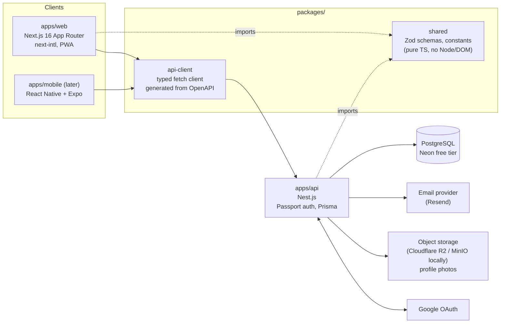

# Architecture

SkillBoard Korea is a reverse job marketplace for foreigners in South Korea: talent post themselves
(skills, portfolio, video link), clients (companies **or private individuals**) search and contact them.
MVP is one mobile-first responsive website (PWA). A React Native app comes later on the same API.

## System diagram

## Request flow (one line each)

1. Browser hits Vercel; Next.js renders the page (SSR for public profiles so they are indexable).
2. Server Components and client code call the API through `packages/api-client` (plain `fetch`, works in React Native too).
3. Nest validates every request body/query with the Zod schema from `packages/shared` (via `nestjs-zod`).
4. Services hold business logic; Prisma talks to PostgreSQL. Controllers only route and map.
5. Responses are validated against the Zod output schema too, so the OpenAPI document is always true.

## Repository layout (target after Phase B)

| Path | What lives there | Owner model |
|---|---|---|
| `apps/web` | Next.js app, pages, UI components (shadcn/ui), i18n messages | Sonnet (logic), Opus (design) |
| `apps/api` | Nest modules: `auth`, `users`, `talent-profiles`, `search`, `contact`, `moderation`, `health` | Sonnet |
| `apps/mobile` | Future Expo app. Not created in MVP. | – |
| `packages/shared` | Zod schemas, inferred types, constants (cities, visa types, languages). **No Node or DOM APIs.** | Sonnet |
| `packages/api-client` | `openapi-typescript` types + `openapi-fetch` client, regenerated from the API's OpenAPI JSON | generated |
| `packages/config` | Shared `tsconfig`, ESLint, Prettier presets | Fable |
| `docs/` | Architecture, ADRs, domain, specs, conventions | all |
| `.claude/` | Rules, hooks, skills, subagents | Fable |

## Boundaries (enforced by ESLint in Phase B)

- `apps/web` → may import `packages/*`. Never `apps/api`.
- `apps/api` → may import `packages/shared`. Never `apps/web`, never `packages/api-client`.
- `packages/shared` → imports nothing from `apps/*`; only `zod`.
- Future `chat` module lives in `apps/api/src/modules/chat` and talks to other modules through their services only (see ADR 0015).

## Cross-cutting conventions

Defined once in ADRs, applied everywhere:
IDs are UUID v7 (ADR 0017) · timestamps are UTC `timestamptz`, displayed in `Asia/Seoul` (0017) ·
errors are `{ error: { code, message, details? } }` (0017) · lists are cursor-paginated (0017) ·
every input/output is a Zod schema in `packages/shared` (0006, 0014).

## Library facts verified on 2026-10-14 (Context7)

Pin exact versions in Phase B. These facts are the ones that differ from older tutorials, so agents should not "fix" them.

| Library | Fact that matters |
|---|---|
| Prisma 7 | `datasource` block has only `provider`; the URL lives in `prisma.config.ts` (`defineConfig({ datasource: { url: env('DATABASE_URL') } })`). Generator is `provider = "prisma-client"` with a required `output`. Client needs a driver adapter: `new PrismaClient({ adapter: new PrismaPg({ connectionString }) })`. |
| Next.js 16 | `middleware.ts` is renamed `proxy.ts` (export `proxy`, Node runtime only). PWA manifest is `app/manifest.ts` returning `MetadataRoute.Manifest`. Config file is `next.config.ts`. |
| next-intl 4 | `src/i18n/routing.ts` (`defineRouting`), `src/i18n/request.ts` (`getRequestConfig`), `src/i18n/navigation.ts` (`createNavigation`), `src/proxy.ts` (`createMiddleware(routing)`). |
| Zod 4 | Import from `"zod"`. `z.toJSONSchema(schema)` and `.meta({ description })` feed OpenAPI. `z.infer` = `z.output`. |
| nestjs-zod | `class XDto extends createZodDto(XSchema) {}`; global `ZodValidationPipe`; `SwaggerModule.setup(path, app, cleanupOpenApiDoc(doc))` is required for correct output. |
| Turborepo 2 | `turbo.json` uses `tasks` (not `pipeline`); `dev` is `{ cache: false, persistent: true }`. |
| Nest.js | Use the latest 11.x+ at install time; `@nestjs/swagger`, `@nestjs/throttler`, `@nestjs/websockets` are the official companions used in ADRs. |
