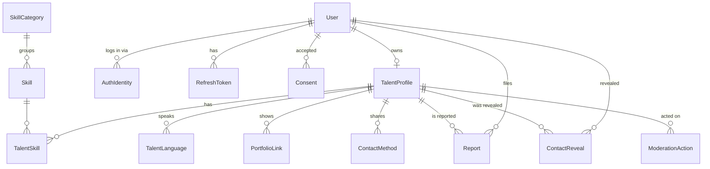

# Domain model

Plain-words description of the entities. The Prisma draft at the bottom is the source for Phase D;
it becomes `apps/api/prisma/schema.prisma` then and this doc keeps only the prose.

## Actors

- **User** – one account, one email. Has one or more **roles**: `TALENT`, `CLIENT`, `ADMIN`.
  A private person who only wants to hire is a `CLIENT` with no company data at all.
- **Talent** – a User with a **TalentProfile** (at most one).
- **Client** – a User who searches and reveals contacts. In MVP a Client has no extra table.
- **Admin** – a User with the `ADMIN` role. Can hide/unhide profiles and resolve reports.
- **Organization** (post-MVP) – a company a User may own later. Reserved, not created now (ADR 0016).

## Entities

| Entity | Purpose | Notes |
|---|---|---|
| `User` | identity, login, UI locale, roles | `passwordHash` is null for Google-only users |
| `AuthIdentity` | links a User to an external provider (`GOOGLE`, `providerUserId`) | allows adding Apple/Kakao login later |
| `RefreshToken` | server-side record of issued refresh tokens (hashed) | rotation + revocation, works for web and mobile |
| `VerificationToken` | one-time tokens: email verification, password reset | hashed, expiring |
| `Consent` | which legal text (terms, privacy, visa disclaimer) a user accepted, which version, when | PIPA audit trail |
| `TalentProfile` | the public card: headline, description, photo, city, work mode, visa type, video link, status | one per User, `slug` for public URL |
| `SkillCategory`, `Skill` | **data, not enums**: categories (Tutoring, Marketing, …) and skills (Russian tutor, SMM, …) with names as JSON `{ en, ko, ru }` | adding "IT" is an insert, not a migration |
| `TalentSkill` | many-to-many Profile ↔ Skill | ordered |
| `TalentLanguage` | languages a talent speaks, with level | ISO 639-1 code, labels via `Intl.DisplayNames` |
| `PortfolioLink` | external links (GitHub, Behance, YouTube) | ordered |
| `ContactMethod` | the channels a talent chose to share: email, Telegram, KakaoTalk ID | hidden until a viewer clicks "Contact" |
| `ContactReveal` | log: who revealed whose contacts, when | abuse detection now; pay-per-contact or limits later |
| `Report` | a user reports a profile with a reason | status open/resolved/dismissed |
| `ModerationAction` | admin hid/unhid a profile and why | audit |

Reference lists that are **config in `packages/shared`**, not tables: cities (Korean city codes), visa types
(`F-2`, `F-4`, `F-5`, `F-6`, `E-7`, `D-10`, `D-2`, `H-1`, `OTHER`, `UNDISCLOSED`), languages (ISO 639-1).
They change rarely, need no admin UI, and the front end needs them at build time for filters.

## Relations in one picture



## Visibility rules (the only business rules that matter in MVP)

A profile is **publicly visible** iff `status = PUBLISHED` **and** `hiddenAt IS NULL`.
Owners always see their own profile. Admins see everything. Search only returns publicly visible profiles.

## Deletion (PIPA)

Account deletion is a **hard delete** of `User` with cascades to everything personal.
Audit rows (`Report`, `ModerationAction`, `ContactReveal`) keep working through `onDelete: SetNull`
on the user reference, so moderation history survives without personal data. See ADR 0018.

## Prisma schema draft (Prisma 7 syntax)

```prisma
// apps/api/prisma/schema.prisma  (DRAFT – becomes real in Phase D)
// DATABASE_URL lives in prisma.config.ts, not here (Prisma 7).

datasource db {
  provider = "postgresql"
}

generator client {
  provider = "prisma-client"
  output   = "../src/generated/prisma"
}

enum UserRole            { TALENT  CLIENT  ADMIN }
enum AuthProvider        { GOOGLE }
enum TokenPurpose        { EMAIL_VERIFY  PASSWORD_RESET }
enum ConsentType         { TERMS  PRIVACY  VISA_DISCLAIMER }
enum ProfileStatus       { DRAFT  PUBLISHED }
enum WorkMode            { REMOTE  ON_SITE  HYBRID }
enum LanguageLevel       { NATIVE  FLUENT  INTERMEDIATE  BASIC }
enum ContactType         { EMAIL  TELEGRAM  KAKAO }
enum ReportReason        { SPAM  SCAM  INAPPROPRIATE  IMPERSONATION  OTHER }
enum ReportStatus        { OPEN  RESOLVED  DISMISSED }
enum ModerationActionType { HIDE  UNHIDE }

model User {
  id              String     @id @default(uuid(7)) @db.Uuid
  email           String     @unique            // stored lower-cased by the service
  emailVerifiedAt DateTime?
  passwordHash    String?                       // argon2id; null = Google-only account
  displayName     String
  locale          String     @default("en")     // UI language; validated against shared locale list
  roles           UserRole[] @default([])
  createdAt       DateTime   @default(now())
  updatedAt       DateTime   @updatedAt

  identities         AuthIdentity[]
  refreshTokens      RefreshToken[]
  verificationTokens VerificationToken[]
  consents           Consent[]
  talentProfile      TalentProfile?
  reportsFiled       Report[]           @relation("ReportReporter")
  reportsResolved    Report[]           @relation("ReportResolver")
  contactReveals     ContactReveal[]
  moderationActions  ModerationAction[]
}

model AuthIdentity {
  id             String       @id @default(uuid(7)) @db.Uuid
  provider       AuthProvider
  providerUserId String
  userId         String       @db.Uuid
  user           User         @relation(fields: [userId], references: [id], onDelete: Cascade)
  createdAt      DateTime     @default(now())

  @@unique([provider, providerUserId])
}

model RefreshToken {
  id        String    @id @default(uuid(7)) @db.Uuid
  tokenHash String    @unique            // sha256 of the opaque token
  userId    String    @db.Uuid
  user      User      @relation(fields: [userId], references: [id], onDelete: Cascade)
  userAgent String?
  expiresAt DateTime
  revokedAt DateTime?
  createdAt DateTime  @default(now())

  @@index([userId])
}

model VerificationToken {
  id        String       @id @default(uuid(7)) @db.Uuid
  tokenHash String       @unique
  purpose   TokenPurpose
  userId    String       @db.Uuid
  user      User         @relation(fields: [userId], references: [id], onDelete: Cascade)
  expiresAt DateTime
  usedAt    DateTime?
  createdAt DateTime     @default(now())
}

model Consent {
  id         String      @id @default(uuid(7)) @db.Uuid
  userId     String      @db.Uuid
  user       User        @relation(fields: [userId], references: [id], onDelete: Cascade)
  type       ConsentType
  version    String                       // e.g. "2026-10-01"; matches the legal page version
  acceptedAt DateTime    @default(now())

  @@unique([userId, type, version])
}

model TalentProfile {
  id          String        @id @default(uuid(7)) @db.Uuid
  userId      String        @unique @db.Uuid
  user        User          @relation(fields: [userId], references: [id], onDelete: Cascade)
  slug        String        @unique            // public URL /t/{slug}
  headline    String                           // max 80 chars (Zod enforces)
  description String                           // max 2000 chars
  photoUrl    String?
  videoUrl    String?                          // external link only (YouTube etc.)
  cityCode    String?                          // from shared CITY list
  workMode    WorkMode      @default(HYBRID)
  visaType    String?                          // self-declared; from shared VISA_TYPES list
  status      ProfileStatus @default(DRAFT)
  publishedAt DateTime?
  hiddenAt    DateTime?                        // set by admin; non-null = hidden from public
  hiddenReason String?
  createdAt   DateTime      @default(now())
  updatedAt   DateTime      @updatedAt

  skills            TalentSkill[]
  languages         TalentLanguage[]
  portfolioLinks    PortfolioLink[]
  contactMethods    ContactMethod[]
  contactReveals    ContactReveal[]
  reports           Report[]
  moderationActions ModerationAction[]

  // Search filters hit these. Composite covers the "publicly visible" predicate + recency sort.
  @@index([status, hiddenAt, publishedAt(sort: Desc)])
  @@index([cityCode])
  @@index([workMode])
  @@index([visaType])
}

model SkillCategory {
  id        String  @id @default(uuid(7)) @db.Uuid
  slug      String  @unique                   // "tutoring", "marketing", "creative", "language-services"
  names     Json                              // { "en": "Tutoring", "ko": "...", "ru": "..." }
  sortOrder Int     @default(0)
  isActive  Boolean @default(true)
  skills    Skill[]
}

model Skill {
  id         String        @id @default(uuid(7)) @db.Uuid
  slug       String        @unique            // "russian-tutor", "smm", "video-editing"
  names      Json
  categoryId String        @db.Uuid
  category   SkillCategory @relation(fields: [categoryId], references: [id])
  sortOrder  Int           @default(0)
  isActive   Boolean       @default(true)
  talents    TalentSkill[]
}

model TalentSkill {
  profileId String        @db.Uuid
  profile   TalentProfile @relation(fields: [profileId], references: [id], onDelete: Cascade)
  skillId   String        @db.Uuid
  skill     Skill         @relation(fields: [skillId], references: [id])
  sortOrder Int           @default(0)

  @@id([profileId, skillId])
  @@index([skillId])
}

model TalentLanguage {
  profileId    String        @db.Uuid
  profile      TalentProfile @relation(fields: [profileId], references: [id], onDelete: Cascade)
  languageCode String                         // ISO 639-1: "ru", "en", "ko"
  level        LanguageLevel

  @@id([profileId, languageCode])
  @@index([languageCode])
}

model PortfolioLink {
  id        String        @id @default(uuid(7)) @db.Uuid
  profileId String        @db.Uuid
  profile   TalentProfile @relation(fields: [profileId], references: [id], onDelete: Cascade)
  url       String
  label     String?
  sortOrder Int           @default(0)
}

model ContactMethod {
  id        String        @id @default(uuid(7)) @db.Uuid
  profileId String        @db.Uuid
  profile   TalentProfile @relation(fields: [profileId], references: [id], onDelete: Cascade)
  type      ContactType
  value     String                           // email address, @telegram, kakao id

  @@unique([profileId, type])
}

model ContactReveal {
  id           String        @id @default(uuid(7)) @db.Uuid
  profileId    String        @db.Uuid
  profile      TalentProfile @relation(fields: [profileId], references: [id], onDelete: Cascade)
  viewerUserId String?       @db.Uuid         // null after the viewer deletes their account
  viewer       User?         @relation(fields: [viewerUserId], references: [id], onDelete: SetNull)
  createdAt    DateTime      @default(now())

  @@index([profileId, createdAt])
  @@index([viewerUserId, createdAt])
}

model Report {
  id             String        @id @default(uuid(7)) @db.Uuid
  profileId      String        @db.Uuid
  profile        TalentProfile @relation(fields: [profileId], references: [id], onDelete: Cascade)
  reporterUserId String?       @db.Uuid
  reporter       User?         @relation("ReportReporter", fields: [reporterUserId], references: [id], onDelete: SetNull)
  reason         ReportReason
  details        String?                      // max 1000 chars
  status         ReportStatus  @default(OPEN)
  resolvedById   String?       @db.Uuid
  resolvedBy     User?         @relation("ReportResolver", fields: [resolvedById], references: [id], onDelete: SetNull)
  resolvedAt     DateTime?
  createdAt      DateTime      @default(now())

  @@index([status, createdAt])
  @@index([profileId])
}

model ModerationAction {
  id          String               @id @default(uuid(7)) @db.Uuid
  profileId   String               @db.Uuid
  profile     TalentProfile        @relation(fields: [profileId], references: [id], onDelete: Cascade)
  adminUserId String?              @db.Uuid
  admin       User?                @relation(fields: [adminUserId], references: [id], onDelete: SetNull)
  action      ModerationActionType
  reason      String
  createdAt   DateTime             @default(now())

  @@index([profileId, createdAt])
}
```

### Why these choices (for the learning owner)

- **Enums vs tables**: an enum is right when the set is part of the *code's* logic (`ProfileStatus` drives
  visibility rules). A table is right when the set is *content* that non-developers extend (skills).
- **`names Json`** instead of `nameEn/nameKo/nameRu` columns: adding a UI language must not need a migration.
- **Hashed tokens**: a leaked DB dump must not log anyone in. Store `sha256(token)`, compare hashes.
- **`ContactReveal`** costs one insert per click and is the single most valuable table for later monetization
  (limits, paid reveals) and abuse detection (one user revealing 500 contacts/hour).
- **No payment or subscription fields** on `User`/`TalentProfile`: monetization arrives as new tables that
  reference these by id (ADR 0016).
