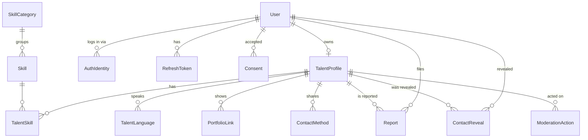

# Domain model

Plain-words description of the entities. The schema itself is `apps/api/prisma/schema.prisma`
(first migration `init_mvp_schema`, Phase D); this page explains the model, the file is the truth.

## Actors

- **User** – one account, one email. Has one or more **roles**: `TALENT`, `CLIENT`, `ADMIN`.
  A private person who only wants to hire is a `CLIENT` with no company data at all.
- **Talent** – a User with a **TalentProfile** (at most one).
- **Client** – a User who searches and reveals contacts. In MVP a Client has no extra table.
- **Admin** – a User with the `ADMIN` role. Can hide/unhide profiles and resolve reports.
- **Organization** (post-MVP) – a company a User may own later. Reserved, not created now (ADR 0016).

## Entities

| Entity                   | Purpose                                                                                                                         | Notes                                                |
| ------------------------ | ------------------------------------------------------------------------------------------------------------------------------- | ---------------------------------------------------- |
| `User`                   | identity, login, UI locale, roles                                                                                               | `passwordHash` is null for Google-only users         |
| `AuthIdentity`           | links a User to an external provider (`GOOGLE`, `providerUserId`)                                                               | allows adding Apple/Kakao login later                |
| `RefreshToken`           | server-side record of issued refresh tokens (hashed)                                                                            | rotation + revocation, works for web and mobile      |
| `VerificationToken`      | one-time tokens: email verification, password reset                                                                             | hashed, expiring                                     |
| `Consent`                | which legal text (terms, privacy, visa disclaimer) a user accepted, which version, when                                         | PIPA audit trail                                     |
| `TalentProfile`          | the public card: headline, description, photo, city, work mode, visa type, video link, status                                   | one per User, `slug` for public URL                  |
| `SkillCategory`, `Skill` | **data, not enums**: categories (Tutoring, Marketing, …) and skills (Russian tutor, SMM, …) with names as JSON `{ en, ko, ru }` | adding "IT" is an insert, not a migration            |
| `TalentSkill`            | many-to-many Profile ↔ Skill                                                                                                    | ordered                                              |
| `TalentLanguage`         | languages a talent speaks, with level                                                                                           | ISO 639-1 code, labels via `Intl.DisplayNames`       |
| `PortfolioLink`          | external links (GitHub, Behance, YouTube)                                                                                       | ordered                                              |
| `ContactMethod`          | the channels a talent chose to share: email, Telegram, KakaoTalk ID                                                             | hidden until a viewer clicks "Contact"               |
| `ContactReveal`          | log: who revealed whose contacts, when                                                                                          | abuse detection now; pay-per-contact or limits later |
| `Report`                 | a user reports a profile with a reason                                                                                          | status open/resolved/dismissed                       |
| `ModerationAction`       | admin hid/unhid a profile and why                                                                                               | audit                                                |

Reference lists that are **config in `packages/shared`**, not tables: cities (Korean city codes), visa types
(`F-2`, `F-4`, `F-5`, `F-6`, `E-7`, `D-10`, `D-2`, `H-1`, `OTHER`, `UNDISCLOSED`), languages (ISO 639-1).
They change rarely, need no admin UI, and the front end needs them at build time for filters.

## Relations in one picture

## Visibility rules (the only business rules that matter in MVP)

A profile is **publicly visible** iff `status = PUBLISHED` **and** `hiddenAt IS NULL`.
Owners always see their own profile. Admins see everything. Search only returns publicly visible profiles.

## Deletion (PIPA)

Account deletion is a **hard delete** of `User` with cascades to everything personal.
Audit rows (`Report`, `ModerationAction`, `ContactReveal`) keep working through `onDelete: SetNull`
on the user reference, so moderation history survives without personal data. See ADR 0018.

## Schema notes

The full MVP schema (all tables above) shipped in one migration so later specs only add columns.
Conventions: `@id @default(uuid(7)) @db.Uuid`, `createdAt`/`updatedAt`, `Cascade` from `User` for
personal data, `SetNull` for audit rows. `cityCode`, `visaType` and `languageCode` are plain text columns
validated against the lists in `packages/shared` (config, not enums, see above). Search filters are
indexed; the composite `(status, hiddenAt, publishedAt desc)` covers the visibility predicate.

### Why these choices (for the learning owner)

- **Enums vs tables**: an enum is right when the set is part of the _code's_ logic (`ProfileStatus` drives
  visibility rules). A table is right when the set is _content_ that non-developers extend (skills).
- **`names Json`** instead of `nameEn/nameKo/nameRu` columns: adding a UI language must not need a migration.
- **Hashed tokens**: a leaked DB dump must not log anyone in. Store `sha256(token)`, compare hashes.
- **`ContactReveal`** costs one insert per click and is the single most valuable table for later monetization
  (limits, paid reveals) and abuse detection (one user revealing 500 contacts/hour).
- **No payment or subscription fields** on `User`/`TalentProfile`: monetization arrives as new tables that
  reference these by id (ADR 0016).
